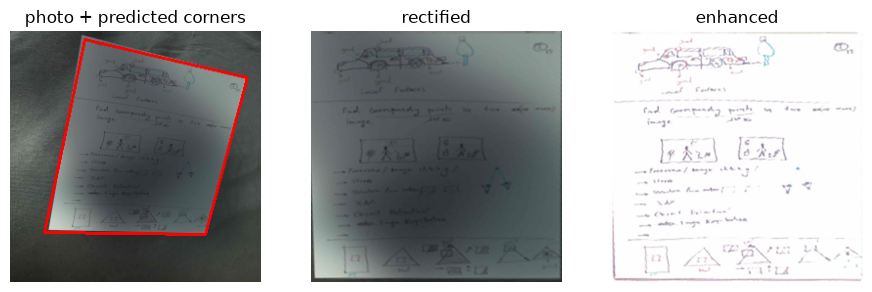
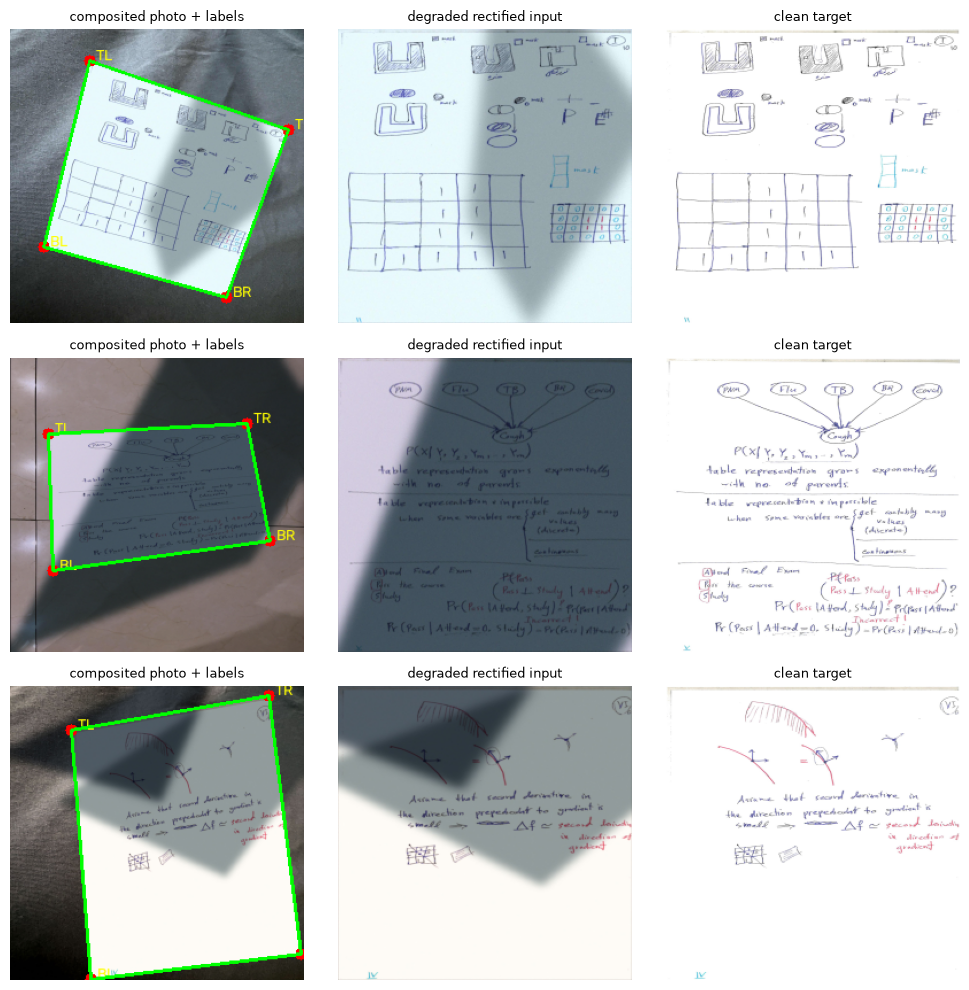
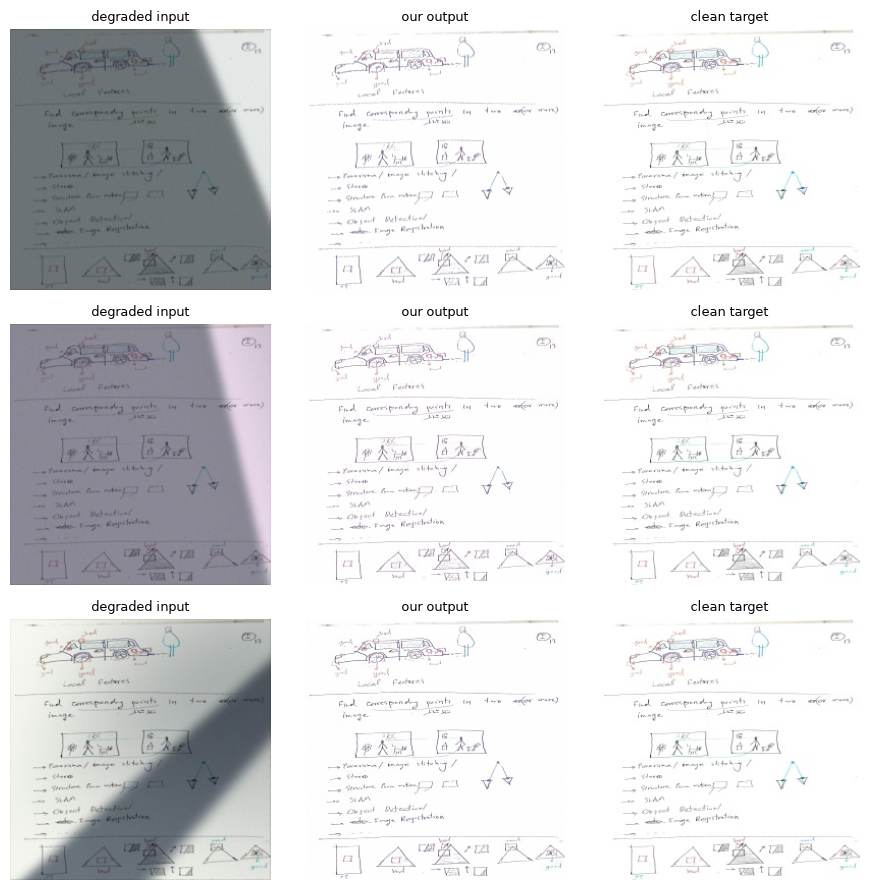
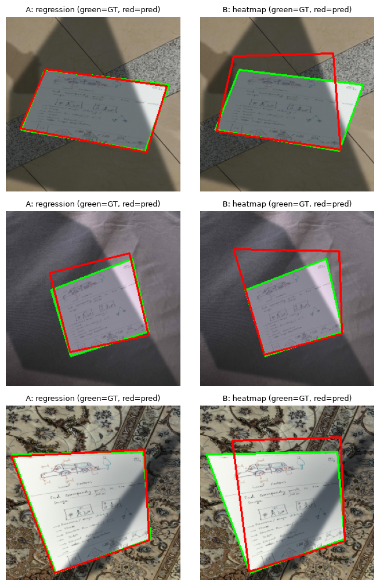

# Document Scanning and Enhancement

This project was developed for the Fundamentals of Computer Vision course at K. N. Toosi University of Technology (Spring 2026).

The goal was to build a document scanner that takes a photo of a page, detects its four corners, corrects the perspective, and enhances the image to produce a cleaner and more readable document.

I implemented the models in PyTorch and used OpenCV and NumPy for synthetic data generation, perspective correction, and image processing. I also compared different approaches to corner detection and experimented with dropout regularization.



## Implementation

The project consists of four main parts:

- **Synthetic data generation:** Generating degraded document photos and their corresponding clean targets from a collection of document scans.
- **Image enhancement:** Implementing a U-Net-style network to restore degraded document images.
- **Corner detection:** Comparing direct coordinate regression and heatmap regression for locating the four document corners.
- **Document scanning pipeline:** Combining corner detection, perspective correction, and image enhancement into a single function.

All networks were implemented using standard PyTorch layers rather than importing pretrained architectures.

## Dataset Preparation

Instead of collecting thousands of labeled document photos, I generated synthetic training data from clean document scans.

Each document was placed on a randomly selected or procedurally generated background using a perspective transformation. The generated corner coordinates were used as labels for the corner detection networks.

I then applied several image degradations:

- Resolution loss
- Brightness, contrast, and color changes
- Shadows and uneven lighting
- Gaussian and motion blur
- Gaussian noise
- JPEG compression

The degraded document was warped back using the known homography to create an aligned input-target pair for the enhancement network.



The source documents were split into training, validation, and test sets using an 80/10/10 ratio before generating the samples. This prevents different degraded versions of the same source document from appearing in different splits.

The generated samples were saved to disk with fixed random seeds.

## Image Enhancement

For document enhancement, I implemented an encoder-decoder CNN with skip connections, based on the U-Net architecture.

The encoder extracts features from the degraded image, while the decoder reconstructs the enhanced image. Skip connections help preserve spatial details that might otherwise be lost during downsampling.

The network takes a rectified RGB document image at a resolution of 256 x 256.

I used a combination of four loss terms:

- L1 loss
- Structural similarity loss (1 - SSIM)
- Sobel gradient loss
- Chroma loss

The gradient loss was included to help preserve text edges, while the chroma loss helps account for unwanted color changes.



## Corner Detection

I implemented two approaches to predicting document corners.

### Coordinate Regression

A CNN encoder followed by fully connected layers predicts eight values representing the normalized coordinates of the four corners.

The model is trained using L1 loss between the predicted and ground truth coordinates.

### Heatmap Regression

A U-Net-style network predicts four 64 x 64 heatmaps, one for each corner.

The target heatmaps contain Gaussian peaks centered at the ground truth corner locations. The predicted coordinates are extracted using soft-argmax.

The training loss combines heatmap MSE with a coordinate regression loss.



## Training

The enhancement and corner detection networks were trained separately using the same source document splits.

| Parameter | Value |
|---|---|
| Framework | PyTorch |
| Input resolution | 256 x 256 |
| Batch size | 16 |
| Optimizer | AdamW |
| Learning rate scheduler | OneCycleLR |
| Initial random seed | 1337 |
| Dataset split | 80 / 10 / 10 |

I also experimented with dropout in the fully connected layers of the coordinate regression network and the bottleneck of the encoder-decoder networks.

## Results

### Image Enhancement

The following results were recorded on the synthetic dataset.

| Split | PSNR (dB) | SSIM |
|---|---:|---:|
| Training | 33.79 | 0.9751 |
| Validation | 33.58 | 0.9751 |
| Test | 33.62 | 0.9756 |

The enhancement model without dropout performed better than the version with dropout in my experiments.

| Model | Test PSNR (dB) | Test SSIM |
|---|---:|---:|
| Without dropout | 33.62 | 0.9756 |
| With dropout (0.2) | 24.00 | 0.7760 |

### Corner Detection

The corner detectors were evaluated using mean corner localization error and the percentage of images where all four predicted corners were within 8 pixels of their ground truth positions.

Errors are measured at the 256-pixel image scale.

| Model | Mean Error (px) | All Four Within 8px |
|---|---:|---:|
| Coordinate regression | 3.03 | 89.58% |
| Coordinate regression + dropout | 5.04 | 68.75% |
| Heatmap regression | 14.63 | 0.00% |
| Heatmap regression + dropout | 0.85 | 100.00% |

The effect of dropout was quite different across the models. It reduced performance in the enhancement and coordinate regression experiments, but improved the heatmap model considerably on the synthetic test set.

### Real Document Photos

One of the main limitations of the project was the difference between synthetic and real images.

The coordinate regression model achieved a mean corner error of 3.03 pixels on the synthetic test set, compared to 27.21 pixels on the real document photos I tested.

The notebook also includes evaluation functions for comparing enhanced documents using Tesseract OCR confidence scores.

Although the synthetic results were good, the models were less reliable on real photos with more complicated backgrounds, lighting conditions, and shadows.

## Document Scanning Pipeline

The final part of the project combines the two networks with perspective correction.

```text
Input photo
    |
Corner detection
    |
Perspective correction
    |
Image enhancement
    |
Scanned document
```

The predicted corners are used to compute a homography with OpenCV. The rectified document is then passed through the enhancement network.

The notebook contains separate inference functions for corner detection and enhancement, as well as a complete scanning function.

## Requirements

- Python
- PyTorch
- OpenCV
- NumPy
- Matplotlib
- JupyterLab

A GPU is recommended for training.

Tesseract OCR and pytesseract are optional and are only needed for OCR-based evaluation.

## Running the Project

Install the dependencies:

```bash
pip install -r requirements.txt
```

Start JupyterLab from the repository root:

```bash
jupyter lab
```

Open `notebooks/document_scanner.ipynb`.

The notebook uses paths relative to the repository root. Make sure its working directory is set to the repository root before running the cells.

Place the clean document scans in a folder named `Sample/`.

Optional background images can be placed in `Backgrounds/`. If no background images are available, the notebook generates them procedurally.

The synthetic training, validation, and test datasets are generated by the notebook.

For real-photo evaluation, the notebook expects images and their corner annotations in `real_photos/`. Reference scans can be placed in `real_photos/reference/`.

The original course dataset, real document photos, and trained model weights are not included in this repository.

## Project Structure

```text
.
├── assets/
│   ├── pipeline_example.png
│   ├── enhancement_examples.png
│   ├── corner_predictions.png
│   └── synthetic_generation.png
├── notebooks/
│   └── document_scanner.ipynb
├── requirements.txt
├── LICENSE
└── README.md
```

---

Course project - Fundamentals of Computer Vision, Spring 2026.

